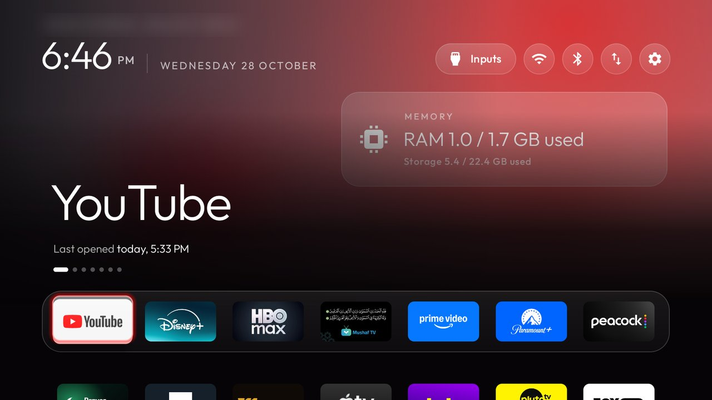

# What this fork adds

This fork follows [Gathin23/cleanyourtv](https://github.com/Gathin23/cleanyourtv) and adds the pieces below. All
of them are off by default; tested on a TCL Q6 (Google TV), Android 12.

## Home widget

One glass panel under the launcher's top buttons that turns through pages: the next prayer from the Prayer Times
add-on, the weather now from the Weather add-on, a warning while debugging is on, RAM and storage in use, and a page
from any add-on that offers one (News: the latest headlines; Prayer Times: the next recitation). Every page has the
same size. As the prayer gets close the panel stays on it and turns orange (`prayer_soon_minutes`, 60), then red
(`prayer_imminent_minutes`, 15). A source with nothing to show is skipped; with none the panel hides.

Turn it on in `launcher/app/src/main/res/values/config.xml` with `<bool name="home_widgets">true</bool>` and pick
the default pages with `widget_sources`; on the TV, **Launcher settings > Home widget** ticks pages on and off,
**Show first** moves one to the front, and **Home widget page** sets 6, 10, 15 or 30 seconds per page. An add-on offers
a page by adding `live="true"` to its module card and a read-only provider; see
[docs/specs/widget-source.md](docs/specs/widget-source.md). The launcher asks for no new permission, opens no
network connection and runs no background service. The Wi-Fi button in the top bar lights 1, 2 or 3 bars for a weak,
moderate or strong signal.

## Three small launcher keys

`bluetooth_button`, `tools_apps` and `icon_tiles`, described in [themes/README.md](themes/README.md) and
[docs/switches.md](docs/switches.md).

## Prayer Times add-on

A settings screen on the TV (city, method, Asr school), and opt-in reminders: a countdown and banner before each
prayer, the Azan at the prayer time, a morning recitation and Al-Kahf on Fridays, which can wake the TV from
standby and put it back afterwards. Its screens and overlays use the Home widget's glass look (dark over other apps). No Azan recording is included; you choose your own. See
[its README](addons/prayer-times/README.md).

## Weather add-on

`NowProvider`, the current conditions the Home widget reads.

## Review

The Prayer Times add-on, the Home card and the merge with upstream were checked before release with
[cross-review](https://github.com/M-khalifa/SkillArray/tree/main/plugins/cross-review/skills/cross-review), part of
[SkillArray](https://github.com/M-khalifa/SkillArray): Claude and Codex review the same code and cross-examine each
other's findings. Three runs gave 33 findings: 31 confirmed and fixed, 1 refuted, and 1 left open at low stakes
(whether the exact prayer times could hint at the city).

The merge with upstream v3.1 and the recitation auto-off were checked the same way before they went in: two runs and
a second round on the fixes gave 16 findings: 15 fixed and 1 refuted. A last single-reviewer pass on
those fixes found four low-stakes edge cases, each of which leaves the TV on rather than turning it off.

The Home widget's pages, the News and Prayer Times pages and the glass look were checked the same way, on top of the
merge with upstream at `985bbd14`: a first run gave 5 findings (a slow add-on could freeze the widget, reads could pile
up, two News refreshes could garble the headline cache, add-on pages showed one turn late, and a caption limit), all
fixed. A second run with fresh reviewers confirmed all 5 fixes and found 3 low-stakes items (a News retry without a
pause, an unticked page's add-on still read, one docs sentence), fixed after it and covered by tests.
