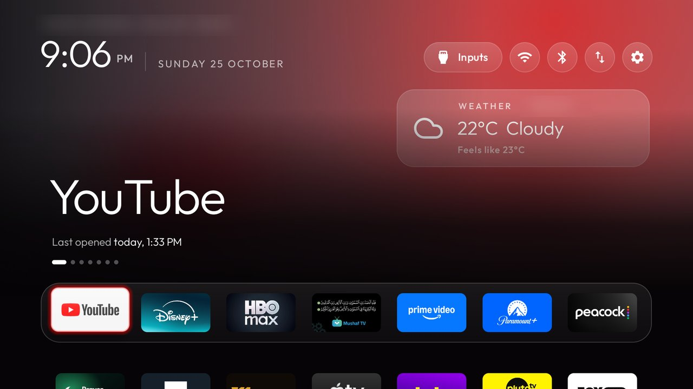

# Prayer and weather card on Home

This branch adds one glass card to the launcher's Home, under the top buttons. It shows the next prayer
from the [Prayer Times](addons/prayer-times/) add-on and the weather now from the [Weather](addons/weather/)
add-on, alternating between the two. With only one of the add-ons installed the card shows that one; with
neither it stays hidden.



As the next prayer gets close the card stops alternating and turns orange (`prayer_soon_minutes`, 60 by
default), then red (`prayer_imminent_minutes`, 15). A weather reading older than three hours is not shown.

It also carries `bluetooth_button`, `tools_apps` and `icon_tiles`, which are proposed upstream on their own.

## Turning it on

The card is off by default. In `launcher/app/src/main/res/values/config.xml` set

```xml
<bool name="home_widgets">true</bool>
```

then build and install as usual: `TV_HOST=<tv ip> launcher/build-and-install.sh`. Install the Weather add-on
from this branch: its `NowProvider` is what the card reads. The prayer side reads a times provider that the
Prayer Times add-on does not have yet (proposed upstream separately); until then the card shows the weather
only.

## What it asks for

Nothing new. The launcher reads the two add-ons' content providers, declared in `<queries>`; it adds no
permission, no network access and no background service.

Tested on a TCL Q6 (Google TV), Android 12.
